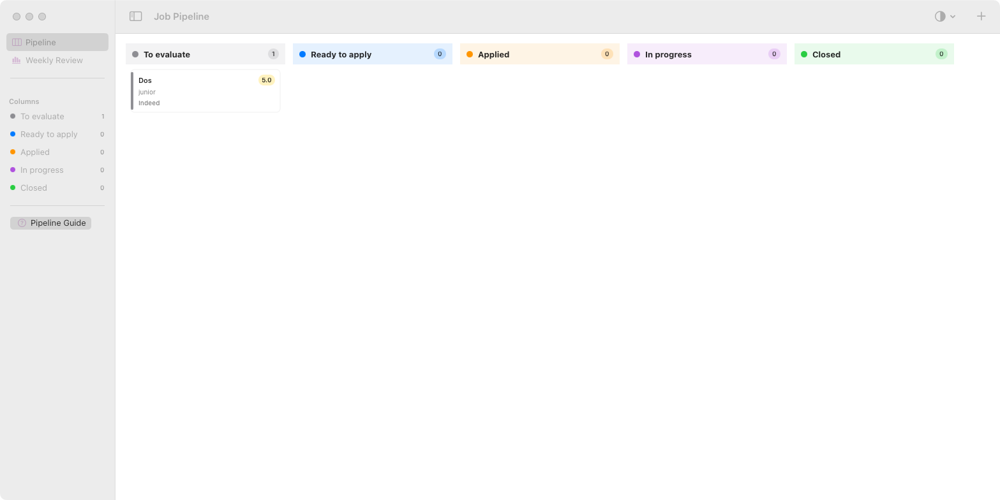

# Job Pipeline

A lightweight, native macOS app to manage your job-application pipeline as a
five-column Kanban board. It is intentionally self-contained: no Xcode project,
no third-party dependencies, and a single local SQLite file for storage.

Built for people who apply to many roles in parallel (contract/EPC, energy,
infrastructure, tech) and want a fast way to see what to evaluate, what to
apply to, what is in flight, and what is closed — plus a weekly review of the
funnel.



## Features

- **Five-column Kanban** — Por evaluar · Lista para aplicar · Aplicada · En proceso · Cerrada
  (To evaluate · Ready to apply · Applied · In progress · Closed).
- **Drag & drop** between columns, or move via the card's context menu.
- **Rich per-card fields** — company, role, URL, platform, work mode, seniority,
  JobFit score, must-have requirement, strengths/gaps, follow-up date, next
  action, local paths to the CV / cover / screenshot you used, contacts, result
  and reason.
- **Follow-up tracking** — a configurable "due soon" window (default 2 days)
  flags cards with a yellow dot, overdue follow-ups with a red badge, and a
  toolbar alert shows how many need attention. When you move a card to
  *Applied*, the next follow-up is auto-scheduled to application date + 7 days
  (only if you haven't set one yourself).
- **Weekly review** — funnel counts, response/conversion rate, overdue and
  upcoming follow-ups, >30-day silence alerts, and recent discard reasons.
- **Import from Obsidian** — parse the YAML frontmatter of your `.md`
  application notes into the local database (folder chosen via the native
  picker, so no special permissions are required).
- **Bilingual UI (Spanish / English)** and **light / dark / automatic**
  appearance, both switchable in Settings.
- **Zero dependencies** — SwiftUI + AppKit + `libsqlite3`.

## Requirements

- macOS 13 Ventura or later.
- Xcode command line tools (`xcrun`, `swiftc`). The build script targets
  `x86_64-apple-macosx13.0`; change `TARGET` in `build.sh` to
  `arm64-apple-macosx13.0` for Apple Silicon.

## Build & run

```bash
./build.sh
cp -R /tmp/JobPipeline_build/JobPipeline.app /Applications/
open /Applications/JobPipeline.app
```

`build.sh` compiles every Swift file under `Sources/`, assembles a `.app`
bundle, copies the icon resources and ad-hoc code-signs the result. Because the
app is built locally it is not quarantined, so Gatekeeper will not block it.

## Project layout

```
Job-Pipeline/
├── build.sh                 # compile + bundle + ad-hoc sign
├── Info.plist               # bundle metadata
├── Sources/
│   ├── App.swift            # @main app + AppStore (observable state)
│   ├── Models/Models.swift  # Application, PipelineColumn, Modalidad, Resultado
│   ├── Services/
│   │   ├── DatabaseService.swift   # SQLite CRUD (no external deps)
│   │   ├── ImportService.swift     # Obsidian YAML frontmatter importer
│   │   └── Localization.swift      # ES→EN table with Spanish fallback
│   └── Views/
│       ├── KanbanViews.swift       # board, columns, cards, drag & drop
│       ├── DetailViews.swift       # card detail, new-application, import
│       ├── ReviewAndSettings.swift # weekly review + settings
│       └── HelpView.swift          # in-app guide (columns, transitions, fields)
└── Resources/               # app icons (light / dark) + asset catalog
```

## How the pipeline works

Each application is one card. Cards move through the columns as you act on
them; the columns answer "what should I do with this?", while the fields answer
"what do I know about it?". The in-app **Pipeline Guide** (⌘?) documents every
column's entry/exit criteria and the T1–T10 transitions.

Data is stored in a single SQLite file at
`~/Library/Application Support/JobPipeline/pipeline.sqlite`. Column, modality
and result values are persisted in Spanish regardless of the interface
language, so switching language never touches your data.

## Privacy

The app requests no macOS privacy permissions (no camera, microphone, contacts,
calendar, reminders, location, screen recording or full-disk access). Everything
stays local.

## License

Released under the [MIT License](LICENSE).
